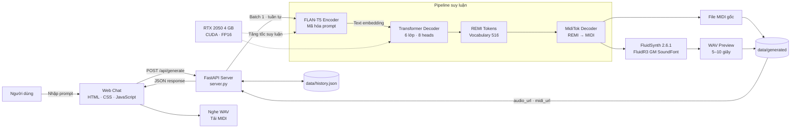

# MusicGen2.0

MusicGen2.0 là hệ thống web chat tạo nhạc từ mô tả văn bản. Người dùng nhập một prompt, mô hình tạo chuỗi token nhạc, giải mã thành MIDI và render WAV bằng FluidSynth + SoundFont để nghe ngay trên trình duyệt. File MIDI gốc vẫn có thể tải về để phối khí bằng DAW.

Hệ thống được cấu hình cho máy cá nhân, đặc biệt là NVIDIA RTX 2050 Laptop GPU 4 GB VRAM: mô hình nạp theo nhu cầu, dùng FP16 trên CUDA, xử lý từng yêu cầu tuần tự và giới hạn độ dài sinh mặc định ở 256 token.

## Tính năng

- Web chat responsive, có lịch sử hội thoại và tìm kiếm.
- Sinh MIDI từ prompt tiếng Anh hoặc tiếng Việt.
- Nghe WAV preview dài 5–10 giây bằng FluidSynth + `FluidR3 GM.sf2` và tải file `.mid`.
- Lưu lịch sử cục bộ dưới dạng JSON, không cần cơ sở dữ liệu.
- API FastAPI có tài liệu tự động tại `/docs`.
- Tự chọn CUDA khi PyTorch nhận GPU; tự chuyển về CPU nếu không có CUDA.
- Nạp mô hình ở yêu cầu đầu tiên để server khởi động nhanh.
- Khóa sinh nhạc để không có hai tác vụ cùng chiếm VRAM.
- Báo lỗi rõ ràng khi thiếu model hoặc hết VRAM.

## Kiến trúc



Luồng xử lý bắt đầu khi web chat gửi prompt tới API. FLAN-T5 biến văn bản thành embedding, Transformer Decoder sinh chuỗi token REMI, sau đó MidiTok giải mã thành MIDI. MIDI gốc được lưu để tải xuống; FluidSynth dùng `FluidR3 GM.sf2` render WAV 44,1 kHz để phát trên trình duyệt. Motif ngắn được lặp đến tối thiểu 5 giây và kết quả dài được giới hạn ở 10 giây. Lịch sử và đường dẫn kết quả được lưu cục bộ dưới dạng JSON.

Mô hình `TextToMidiTransformer` có cấu hình lấy trực tiếp từ checkpoint:

| Thành phần | Giá trị |
|---|---:|
| Text encoder | `google/flan-t5-base` |
| MIDI vocabulary | 516 token |
| Hidden size | 512 |
| Attention heads | 8 |
| Decoder layers | 6 |
| Maximum sequence | 1024 |
| Tokenization | REMI / MidiTok 3.1 |
| Số tham số khi nạp | khoảng 136,3 triệu |

## Cấu trúc thư mục

```text
MusicGen2.0/
├─ server.py                         # Web server, API, history, audio preview
├─ model.py                          # FLAN-T5 + Transformer MIDI decoder
├─ pyproject.toml                    # Dependency dự án
├─ uv.lock                           # Phiên bản dependency đã khóa
├─ models/
│  ├─ best_text2midi_model.pt        # Checkpoint đã huấn luyện
│  └─ midi_tokenizer_config.json     # Cấu hình REMI, vocab 516
├─ soundfonts/
│  ├─ FluidR3 GM.sf2                 # SoundFont General MIDI dùng khi render
│  └─ fluidsynth-v2.6.1-win10-x64-cpp11/
│     └─ bin/fluidsynth.exe          # FluidSynth Windows x64 tích hợp
├─ static/
│  ├─ index.html
│  ├─ app.js
│  └─ style.css
└─ data/                             # Tự tạo khi chạy
   ├─ history.json
   └─ generated/                     # WAV và MIDI đã sinh
```

## Yêu cầu

- Windows 10/11 64-bit.
- Python 3.12.
- Khuyến nghị dùng `uv` để tái tạo đúng môi trường.
- NVIDIA RTX 2050 4 GB hoặc GPU CUDA tương đương; vẫn chạy được bằng CPU nhưng rất chậm.
- NVIDIA driver còn được hỗ trợ và PyTorch bản CUDA.
- FluidSynth Windows x64 và một SoundFont `.sf2` (đã có sẵn trong `soundfonts/`).
- Khoảng 8 GB dung lượng trống cho môi trường CUDA, checkpoint và cache FLAN-T5.
- RAM hệ thống khuyến nghị từ 16 GB.

## Cài đặt

### 1. Tạo môi trường

Mở PowerShell tại thư mục dự án:

```powershell
uv sync
```

Lệnh này tạo `.venv` và cài dependency theo `uv.lock`.

### 2. PyTorch CUDA cho RTX 2050

`pyproject.toml` đã cấu hình nguồn wheel CUDA 12.8 và `uv.lock` đã khóa `torch 2.11.0+cu128`. Vì vậy `uv sync` sẽ cài đúng bản CUDA. Nếu môi trường cũ vẫn còn PyTorch CPU, đồng bộ lại:

```powershell
$env:UV_CACHE_DIR = ".uv-cache"
uv sync
```

Không cần cài CUDA Toolkit riêng nếu dùng wheel chính thức; cần NVIDIA driver tương thích. Kiểm tra:

```powershell
.\.venv\Scripts\python.exe -c "import torch; print(torch.__version__); print(torch.cuda.is_available()); print(torch.cuda.get_device_name(0) if torch.cuda.is_available() else 'CPU')"
```

Kết quả đúng phải có `True` và tên GPU NVIDIA. Nếu vẫn là `False`, kiểm tra driver bằng `nvidia-smi`, sau đó kiểm tra lại wheel PyTorch đã cài có hậu tố CUDA thay vì `+cpu`.

### 3. FluidSynth và SoundFont

Dự án hiện dùng các file sau:

```text
soundfonts/FluidR3 GM.sf2
soundfonts/fluidsynth-v2.6.1-win10-x64-cpp11/bin/fluidsynth.exe
```

Kiểm tra FluidSynth:

```powershell
& ".\soundfonts\fluidsynth-v2.6.1-win10-x64-cpp11\bin\fluidsynth.exe" --version
```

Server tự tìm binary theo mẫu `soundfonts/fluidsynth-*-win10-x64-cpp11/bin/fluidsynth.exe`. Nếu không tìm thấy FluidSynth hoặc SoundFont, hệ thống fallback sang bộ tạo sóng sin để vẫn có thể trả WAV.

### 4. FLAN-T5

Lần đầu nạp mô hình, Transformers cần các file cấu hình/tokenizer của `google/flan-t5-base` và sẽ lưu vào Hugging Face cache. Máy cần Internet ở lần chạy đầu. Checkpoint của dự án đã chứa trọng số encoder dùng cho suy luận, nhưng tokenizer vẫn phải có trong cache.

Chạy một lần để tải cache nếu cần:

```powershell
.\.venv\Scripts\python.exe -c "from transformers import T5Tokenizer; T5Tokenizer.from_pretrained('google/flan-t5-base')"
```

## Khởi chạy

```powershell
uv run python server.py
```

Mở [http://127.0.0.1:8000](http://127.0.0.1:8000). Tài liệu API ở [http://127.0.0.1:8000/docs](http://127.0.0.1:8000/docs).

Server khởi động trước, model chỉ nạp khi gửi prompt đầu tiên. Vì vậy lần sinh đầu sẽ lâu hơn. Không đóng cửa sổ PowerShell trong lúc sử dụng.

Cho phép máy khác trong LAN truy cập:

```powershell
$env:MUSICGEN_HOST = "0.0.0.0"
uv run python server.py
```

Chỉ mở firewall/cổng 8000 trong mạng tin cậy; ứng dụng chưa có xác thực người dùng.

## Cấu hình cho VRAM 4 GB

Các biến môi trường có thể đặt trước khi chạy:

| Biến | Mặc định | Ý nghĩa |
|---|---:|---|
| `MUSICGEN_HOST` | `127.0.0.1` | Địa chỉ bind server |
| `MUSICGEN_PORT` | `8000` | Cổng HTTP |
| `MUSICGEN_MAX_STEPS` | `256` | Độ dài MIDI token, khoảng 32–512 |
| `MUSICGEN_TEMPERATURE` | `1.0` | Độ ngẫu nhiên, khoảng 0.1–2.0 |
| `MUSICGEN_TOP_K` | `50` | Số ứng viên token mỗi bước |
| `MUSICGEN_CFG_SCALE` | `3.0` | Mức bám prompt, khoảng 0–8 |

Thiết lập an toàn hơn nếu gặp thiếu VRAM:

```powershell
$env:MUSICGEN_MAX_STEPS = "128"
$env:MUSICGEN_CFG_SCALE = "2.5"
uv run python server.py
```

Khuyến nghị cho RTX 2050 4 GB:

- Đóng game, trình dựng video và ứng dụng AI khác trước khi chạy.
- Dùng batch size 1; server đã cưỡng chế xử lý tuần tự.
- Bắt đầu ở 128–256 steps. 512 steps tốn nhiều thời gian và activation memory.
- Không chạy `--reload`, vì reloader có thể tạo thêm tiến trình và nạp model lần nữa.
- Kiểm tra VRAM bằng `nvidia-smi` trong một PowerShell khác.
- FP16 được bật tự động khi `device` là CUDA; CPU dùng FP32 để đảm bảo tương thích.

## Sử dụng

Prompt tốt nên nêu thể loại, nhạc cụ, cảm xúc, nhịp độ và bối cảnh. Ví dụ:

```text
An emotional solo piano melody in C minor, 80 BPM, cinematic and spacious
Upbeat electronic pop with bright synths, punchy drums and a catchy chorus
Nhạc jazz buồn cho đêm mưa, piano và saxophone, nhịp chậm
```

Sau khi sinh:

- Nút phát nghe bản WAV preview.
- “Tải file MIDI” lấy kết quả MIDI để mở trong FL Studio, Ableton Live, Reaper hoặc DAW khác.
- Sidebar lưu các phiên chat; nút xóa chỉ xóa chỉ mục lịch sử. File đã sinh vẫn nằm trong `data/generated/` để tránh mất dữ liệu ngoài ý muốn.

WAV trên web được render ở 44,1 kHz bằng FluidSynth và `soundfonts/FluidR3 GM.sf2`, nên program và kênh trống General MIDI được phát bằng nhạc cụ tương ứng. Đây vẫn là SoundFont GM; guitar distortion hoặc nhạc cụ chuyên dụng trong DAW có thể cho chất lượng tốt hơn.

WAV giữ độ dài tự nhiên khi nằm trong khoảng 5–10 giây. Nếu kết quả ngắn hơn 5 giây, audio của motif được lặp đến đủ 5 giây; nếu dài hơn 10 giây, preview được cắt ở 10 giây. File MIDI tải xuống vẫn giữ kết quả gốc và không bị lặp ở bước hậu xử lý audio.

```powershell
& ".\soundfonts\fluidsynth-v2.6.1-win10-x64-cpp11\bin\fluidsynth.exe" `
  -ni -F output.wav -r 44100 `
  ".\soundfonts\FluidR3 GM.sf2" ".\data\generated\TEN_FILE.mid"
```

## API

### Trạng thái

```http
GET /api/health
```

Trả về trạng thái checkpoint, thiết bị, CUDA, GPU, việc model đã được nạp, `audio_renderer` (`fluidsynth` hoặc `sine`) và tên SoundFont.

### Sinh nhạc

```http
POST /api/generate
Content-Type: application/json

{
  "prompt": "Gentle lo-fi piano for studying",
  "session_id": null,
  "max_steps": 256,
  "temperature": 1.0,
  "top_k": 50,
  "cfg_scale": 3.0
}
```

Kết quả chứa `session_id`, `audio_url`, `midi_url`, `duration` và metadata thiết bị.

### Lịch sử

```text
GET    /api/history
GET    /api/history/{session_id}
DELETE /api/history/{session_id}
DELETE /api/history
```

## Dữ liệu và bảo mật

- Prompt và metadata được lưu cục bộ trong `data/history.json`.
- MIDI/WAV được lưu trong `data/generated/`.
- Không có prompt nào được API của ứng dụng gửi ra ngoài. Transformers chỉ liên hệ Hugging Face khi cần tải/cache FLAN-T5.
- Không công khai server ra Internet nếu chưa bổ sung reverse proxy, HTTPS, xác thực, giới hạn tốc độ và quota lưu trữ.

## Xử lý sự cố

### Health báo `device: cpu`

PyTorch đang là bản CPU hoặc không thấy driver. Chạy kiểm tra CUDA ở phần cài đặt. Không chỉ cài CUDA Toolkit; wheel PyTorch phải là bản CUDA.

### `CUDA out of memory`

Giảm `MUSICGEN_MAX_STEPS` xuống 128 hoặc 64, đóng tiến trình dùng GPU, khởi động lại server để giải phóng toàn bộ VRAM và kiểm tra `nvidia-smi`.

### Không tải được `google/flan-t5-base`

Kiểm tra Internet/proxy, chạy riêng lệnh tải tokenizer, hoặc sao chép Hugging Face cache từ máy khác. Sau khi cache đầy đủ có thể đặt `HF_HUB_OFFLINE=1` để chạy offline.

### Lần đầu sinh mất nhiều thời gian

Đây là hành vi dự kiến: server phải đọc checkpoint khoảng 724 MB, khởi tạo FLAN-T5 và chuyển model sang GPU. Những lần sau tái sử dụng model đã nạp.

### Health báo `audio_renderer: sine`

Server không tìm thấy `fluidsynth.exe` hoặc `FluidR3 GM.sf2`. Kiểm tra đúng cấu trúc thư mục ở phần cài đặt và chạy trực tiếp `fluidsynth.exe --version`. Sau khi sửa, khởi động lại server.

### WAV chưa giống nhạc cụ trên Colab hoặc DAW

FluidR3 GM là SoundFont General MIDI, không phải thư viện nhạc cụ chuyên sâu. Chất lượng còn phụ thuộc program do MIDI sinh ra và chính checkpoint. Có thể tải MIDI vào DAW rồi thay SoundFont/VST cho guitar, bass và trống chất lượng cao hơn.

### CPU chạy quá chậm

Sinh autoregressive phải chạy decoder nhiều lần; CPU chỉ là fallback chức năng. Hãy cài đúng PyTorch CUDA và xác nhận `/api/health` trả về `device: cuda`.

## Chuẩn bị dữ liệu và huấn luyện

> Phần này chỉ cần thiết khi muốn huấn luyện lại model. Để chạy web bằng checkpoint có sẵn trong `models/`, có thể bỏ qua toàn bộ phần này.
>
> Bốn file `download-midicaps.py`, `preprocess.py`, `data.py` và `train.py` được sử dụng trong **Google Colab** để tải dữ liệu, tiền xử lý và huấn luyện. Chúng không thuộc runtime web chạy trên máy cá nhân và không cần thiết cho inference bằng checkpoint có sẵn.

### Môi trường Google Colab

Tạo một notebook Colab, chọn **Runtime → Change runtime type → T4 GPU**, sau đó tải bốn script lên Colab hoặc đặt chúng trong Google Drive. Nên lưu dataset, token đã xử lý và checkpoint trong Drive để dữ liệu không mất khi phiên Colab bị ngắt.

Mount Google Drive:

```python
from google.colab import drive
drive.mount("/content/drive")
```

Ví dụ cấu trúc thư mục làm việc:

```text
/content/drive/MyDrive/MusicGen/
├─ download-midicaps.py
├─ preprocess.py
├─ data.py
├─ train.py
├─ model.py
├─ models/
├─ data_midicaps/
│  ├─ midicaps.tar.gz
│  └─ midi_files/
├─ processed_data/
└─ checkpoints/
```

Di chuyển vào thư mục training và cài dependency cần thiết:

```python
%cd /content/drive/MyDrive/MusicGen
!pip install -q torch transformers sentencepiece miditok symusic datasets huggingface_hub tqdm matplotlib
```

Các lệnh bắt đầu bằng `!` hoặc `%` dưới đây được chạy trong ô code của notebook Colab, không chạy trong PowerShell của web server.

### 1. Tải MIDICaps

Dataset dùng để huấn luyện là [MidiCaps trên Hugging Face](https://huggingface.co/datasets/amaai-lab/MidiCaps), repo ID chính xác trong code là `amaai-lab/MidiCaps`. Script đọc split `train`, tải metadata bằng `datasets` và tải archive MIDI `midicaps.tar.gz` bằng `huggingface_hub`.

Chạy script tải dữ liệu trong một ô Colab:

```python
!python download-midicaps.py
```

Cấu trúc dữ liệu mong đợi:

```text
data_midicaps/
├─ midicaps.tar.gz       # archive khoảng 1,2 GB từ Hugging Face
└─ midi_files/           # archive được giải nén tại đây
```

`download-midicaps.py` dùng cột `location` để ghép đường dẫn MIDI và giữ các trường `caption`, `genre`, `mood`, `tempo`, `key` trong danh sách `valid_pairs`. `BASE_DIR` mặc định là `./data_midicaps`; khi chạy lâu dài trên Colab nên đổi trực tiếp biến này thành `/content/drive/MyDrive/MusicGen/data_midicaps`.

### 2. Tiền xử lý MIDI

```python
!python preprocess.py
```

Quy trình tiền xử lý:

1. Đọc caption và file MIDI tương ứng từ MIDICaps.
2. Kiểm tra MIDI có thể parse được, có track/note hợp lệ và không bị hỏng.
3. Chuẩn hóa hoặc lọc các bản quá ngắn, quá dài hay không có note.
4. Tạo `TokenizerConfig` với 16 mức velocity, chord, tempo, program và một token stream cho program; sau đó mã hóa MIDI bằng MidiTok `REMI`.
5. Giới hạn hoặc chia chuỗi theo `max_seq_len=1024` và thêm padding mask.
6. Tokenize caption bằng `google/flan-t5-base`, tối đa 128 text token.
7. Lưu `text_ids` và `midi_ids` dạng `int32` cùng `midi_vocab_size` và `pad_token_id` vào `/content/drive/MyDrive/MusicGen/processed_data/midicaps_processed_{N}.pt`.

Cấu hình tokenizer được tạo bởi `preprocess.py` và lưu tại `/content/drive/MyDrive/MusicGen/processed_data/midi_tokenizer_config.json`. Với cấu hình/checkpoint hiện tại vocabulary có 516 token; tokenizer sinh ra trong Colab phải được chép về `models/midi_tokenizer_config.json` cùng checkpoint.

`SUBSET_SIZE` hiện là `10000`; đặt thành `None` để xử lý toàn bộ khoảng 168 nghìn mẫu. MIDI ngắn hơn 32 token hoặc parse lỗi bị bỏ qua. Script dùng `ProcessPoolExecutor` với `CPU count - 1` worker và hiện gom các mẫu hợp lệ trong RAM trước khi ghi một file `.pt`. Khi đổi tokenizer hoặc độ dài chuỗi, cần tiền xử lý lại; không trộn các file token sinh bởi cấu hình REMI khác nhau.

Kiểm tra Dataset và DataLoader:

```python
!python data.py
```

`data.py` tìm tất cả file `midicaps_*.pt`, trộn cố định với seed 42 rồi chia 90% training và 10% validation. Collate function dynamic-pad text/MIDI và tạo `text_attention_mask`, `midi_padding_mask`. Lệnh kiểm tra dùng batch size 8, `num_workers=0` và in shape của batch đầu tiên.

### 3. Huấn luyện Text-to-MIDI

```python
!python train.py
```

Cấu hình tham khảo:

| Tham số | Giá trị tham khảo |
|---|---:|
| Batch size | 4 |
| Gradient accumulation | 8 |
| Effective batch size | 32 |
| Epochs | 50 |
| Learning rate | `2e-4` |
| Minimum learning rate | `1e-6` |
| Weight decay | `0.01` |
| CFG prompt dropout | `0.2` |
| Scheduler | Cosine Annealing Warm Restarts, `T_0=15`, `T_mult=2` |
| Maximum MIDI sequence | 1024 token |
| Maximum text sequence | 128 token |
| Early stopping patience | 5 epoch |

Trong mỗi batch, FLAN-T5 mã hóa caption thành text embedding. Transformer Decoder nhận chuỗi MIDI được dịch phải bằng BOS token và học dự đoán REMI token kế tiếp với causal attention. CFG prompt dropout tạo các mẫu không điều kiện để hỗ trợ Classifier-Free Guidance khi suy luận.

Training dùng gradient clipping với `max_norm=1.0`, CFG dropout, resume checkpoint, early stopping và theo dõi validation loss cùng top-1/top-5/top-10 token accuracy. **Phiên bản `train.py` hiện tại chưa dùng AMP/autocast hoặc GradScaler.** Checkpoint được ghi thẳng vào Google Drive:

```text
/content/drive/MyDrive/MusicGen/checkpoints/best_text2midi_model.pt
```

Ngoài checkpoint tốt nhất, script luôn lưu `last_text2midi_model.pt` để tiếp tục từ epoch gần nhất và ghi biểu đồ `training_curves.png` vào cùng thư mục.

Checkpoint cần chứa `model_state_dict`, trạng thái optimizer và scheduler, epoch, validation metrics, lịch sử huấn luyện và `model_config`. `model_config` phải khớp kiến trúc server đang nạp: vocabulary 516, hidden size 512, 8 attention heads, 6 decoder layers và maximum sequence 1024.

> **Chênh lệch cần lưu ý:** `TransformerDecoderLayer` trong `train.py` đang dùng giá trị mặc định `norm_first=False`, trong khi `model.py` của web đặt `norm_first=True`. Hai cấu hình có cùng shape trọng số nên checkpoint vẫn nạp được, nhưng thứ tự LayerNorm khi inference không giống lúc training. Trước lần huấn luyện tiếp theo nên thống nhất hai file về cùng một giá trị; không đổi tùy ý đối với checkpoint đã huấn luyện nếu chưa đánh giá lại chất lượng.

Sau khi huấn luyện xong, tải checkpoint từ Google Drive về máy và chép/đổi tên thành:

```text
MusicGen2.0/models/best_text2midi_model.pt
```

Server đọc `model_config` từ checkpoint để dựng kiến trúc và dùng file này cho inference. Cấu hình tokenizer trên máy chạy web cũng phải giống tokenizer đã dùng trong Colab.

Thiết lập batch size 4 được thiết kế cho Google Colab T4 15 GB. RTX 2050 4 GB của máy cá nhân chủ yếu dùng để inference; toàn bộ quá trình tải MIDICaps, tiền xử lý và training được thực hiện trên Colab. Nếu Colab vẫn hết VRAM:

- Giảm batch size xuống 1.
- Tăng gradient accumulation để giữ effective batch size.
- FLAN-T5 đã được đóng băng trong code. Muốn giảm thêm VRAM cần tự bổ sung AMP/autocast hoặc gradient checkpointing vì hai tính năng này chưa được cài đặt trong script hiện tại.
- Giảm `max_seq_len`, số layer hoặc hidden size nếu vẫn hết VRAM.
- Khởi động lại Colab runtime nếu bộ nhớ GPU không được giải phóng sau lỗi.

## Kiểm tra nhanh

```powershell
.\.venv\Scripts\python.exe -m py_compile model.py server.py
.\.venv\Scripts\python.exe -c "import server; print(server.health())"
```

Sau khi server chạy, có thể kiểm tra:

```powershell
Invoke-RestMethod http://127.0.0.1:8000/api/health
```

## Giới hạn hiện tại

- Quá trình sinh autoregressive chưa có KV cache, nên thời gian tăng nhanh theo `max_steps`.
- Một worker duy nhất được khuyến nghị vì mỗi worker giữ một bản model trong VRAM.
- Lịch sử JSON phù hợp máy cá nhân, không dành cho ghi đồng thời quy mô lớn.
- Preview WAV dùng FluidR3 GM nên bị giới hạn bởi chất lượng và bộ nhạc cụ General MIDI của SoundFont.
- Motif ngắn được lặp ở WAV để đạt 5 giây; file MIDI gốc không được kéo dài.
- Chất lượng phụ thuộc checkpoint và miền dữ liệu huấn luyện; prompt cụ thể thường ổn định hơn prompt quá ngắn.

## Bản quyền và mô hình

Hãy kiểm tra giấy phép của checkpoint, FLAN-T5, MidiTok và SoundFont trước khi phân phối hoặc sử dụng thương mại. File nhạc sinh ra cũng cần được đánh giá theo quy định tại khu vực sử dụng.
