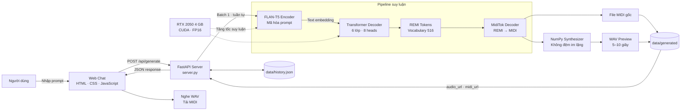

# MusicGen2.0

MusicGen2.0 là hệ thống web chat tạo nhạc từ mô tả văn bản. Người dùng nhập một prompt, mô hình tạo chuỗi token nhạc, giải mã thành MIDI và dựng một bản WAV nhẹ để nghe ngay trên trình duyệt. File MIDI gốc có thể tải về để phối khí bằng DAW hoặc SoundFont.

Hệ thống được cấu hình cho máy cá nhân, đặc biệt là NVIDIA RTX 2050 Laptop GPU 4 GB VRAM: mô hình nạp theo nhu cầu, dùng FP16 trên CUDA, xử lý từng yêu cầu tuần tự và giới hạn độ dài sinh mặc định ở 256 token.

## Tính năng

- Web chat responsive, có lịch sử hội thoại và tìm kiếm.
- Sinh MIDI từ prompt tiếng Anh hoặc tiếng Việt.
- Nghe WAV preview dài 5–10 giây và tải file `.mid`; WAV không được đệm im lặng.
- Lưu lịch sử cục bộ dưới dạng JSON, không cần cơ sở dữ liệu.
- API FastAPI có tài liệu tự động tại `/docs`.
- Tự chọn CUDA khi PyTorch nhận GPU; tự chuyển về CPU nếu không có CUDA.
- Nạp mô hình ở yêu cầu đầu tiên để server khởi động nhanh.
- Khóa sinh nhạc để không có hai tác vụ cùng chiếm VRAM.
- Báo lỗi rõ ràng khi thiếu model hoặc hết VRAM.

## Kiến trúc



Luồng xử lý bắt đầu khi web chat gửi prompt tới API. FLAN-T5 biến văn bản thành embedding, Transformer Decoder sinh chuỗi token REMI, sau đó MidiTok giải mã thành MIDI. MIDI gốc được lưu để tải xuống, đồng thời NumPy tạo WAV preview dài 5–10 giây để phát ngay trên trình duyệt. Lịch sử và đường dẫn kết quả được lưu cục bộ dưới dạng JSON.

Mô hình `TextToMidiTransformer` có cấu hình lấy trực tiếp từ checkpoint:

| Thành phần | Giá trị |
|---|---:|
| Text encoder | `google/flan-t5-base` |
| MIDI vocabulary | 516 token |
| Hidden size | 512 |
| Attention heads | 8 |
| Decoder layers | 6 |
| Maximum sequence | 1024 |
| Tokenization | REMI / MidiTok 3.1 |
| Số tham số khi nạp | khoảng 136,3 triệu |

## Cấu trúc thư mục

```text
MusicGen2.0/
├─ server.py                         # Web server, API, history, audio preview
├─ model.py                          # FLAN-T5 + Transformer MIDI decoder
├─ pyproject.toml                    # Dependency dự án
├─ uv.lock                           # Phiên bản dependency đã khóa
├─ models/
│  ├─ best_text2midi_model.pt        # Checkpoint đã huấn luyện
│  └─ midi_tokenizer_config.json     # Cấu hình REMI, vocab 516
├─ soundfonts/
│  └─ FluidR3 GM.sf2                 # SoundFont để render ngoài hệ thống
├─ static/
│  ├─ index.html
│  ├─ app.js
│  └─ style.css
└─ data/                             # Tự tạo khi chạy
   ├─ history.json
   └─ generated/                     # WAV và MIDI đã sinh
```

## Yêu cầu

- Windows 10/11 64-bit.
- Python 3.12.
- Khuyến nghị dùng `uv` để tái tạo đúng môi trường.
- NVIDIA RTX 2050 4 GB hoặc GPU CUDA tương đương; vẫn chạy được bằng CPU nhưng rất chậm.
- NVIDIA driver còn được hỗ trợ và PyTorch bản CUDA.
- Khoảng 5 GB dung lượng trống cho môi trường, checkpoint và cache FLAN-T5.
- RAM hệ thống khuyến nghị từ 16 GB.

## Cài đặt

### 1. Tạo môi trường

Mở PowerShell tại thư mục dự án:

```powershell
uv sync
```

Lệnh này tạo `.venv` và cài dependency theo `uv.lock`.

### 2. Cài PyTorch có CUDA cho RTX 2050

Môi trường ban đầu có thể đang dùng PyTorch CPU. Gỡ bản đó và cài wheel CUDA phù hợp theo lệnh hiện hành trên trang **PyTorch – Get Started**. Ví dụ với kho wheel CUDA 12.8:

```powershell
uv pip uninstall torch
uv pip install torch --index-url https://download.pytorch.org/whl/cu128
```

Không cần cài CUDA Toolkit riêng nếu dùng wheel chính thức; cần NVIDIA driver tương thích. Kiểm tra:

```powershell
.\.venv\Scripts\python.exe -c "import torch; print(torch.__version__); print(torch.cuda.is_available()); print(torch.cuda.get_device_name(0) if torch.cuda.is_available() else 'CPU')"
```

Kết quả đúng phải có `True` và tên GPU NVIDIA. Nếu vẫn là `False`, kiểm tra driver bằng `nvidia-smi`, sau đó kiểm tra lại wheel PyTorch đã cài có hậu tố CUDA thay vì `+cpu`.

### 3. FLAN-T5

Lần đầu nạp mô hình, Transformers cần các file cấu hình/tokenizer của `google/flan-t5-base` và sẽ lưu vào Hugging Face cache. Máy cần Internet ở lần chạy đầu. Checkpoint của dự án đã chứa trọng số encoder dùng cho suy luận, nhưng tokenizer vẫn phải có trong cache.

Chạy một lần để tải cache nếu cần:

```powershell
.\.venv\Scripts\python.exe -c "from transformers import T5Tokenizer; T5Tokenizer.from_pretrained('google/flan-t5-base')"
```

## Khởi chạy

```powershell
uv run python server.py
```

Mở [http://127.0.0.1:8000](http://127.0.0.1:8000). Tài liệu API ở [http://127.0.0.1:8000/docs](http://127.0.0.1:8000/docs).

Server khởi động trước, model chỉ nạp khi gửi prompt đầu tiên. Vì vậy lần sinh đầu sẽ lâu hơn. Không đóng cửa sổ PowerShell trong lúc sử dụng.

Cho phép máy khác trong LAN truy cập:

```powershell
$env:MUSICGEN_HOST = "0.0.0.0"
uv run python server.py
```

Chỉ mở firewall/cổng 8000 trong mạng tin cậy; ứng dụng chưa có xác thực người dùng.

## Cấu hình cho VRAM 4 GB

Các biến môi trường có thể đặt trước khi chạy:

| Biến | Mặc định | Ý nghĩa |
|---|---:|---|
| `MUSICGEN_HOST` | `127.0.0.1` | Địa chỉ bind server |
| `MUSICGEN_PORT` | `8000` | Cổng HTTP |
| `MUSICGEN_MAX_STEPS` | `256` | Độ dài MIDI token, khoảng 32–512 |
| `MUSICGEN_TEMPERATURE` | `1.0` | Độ ngẫu nhiên, khoảng 0.1–2.0 |
| `MUSICGEN_TOP_K` | `50` | Số ứng viên token mỗi bước |
| `MUSICGEN_CFG_SCALE` | `3.0` | Mức bám prompt, khoảng 0–8 |

Thiết lập an toàn hơn nếu gặp thiếu VRAM:

```powershell
$env:MUSICGEN_MAX_STEPS = "128"
$env:MUSICGEN_CFG_SCALE = "2.5"
uv run python server.py
```

Khuyến nghị cho RTX 2050 4 GB:

- Đóng game, trình dựng video và ứng dụng AI khác trước khi chạy.
- Dùng batch size 1; server đã cưỡng chế xử lý tuần tự.
- Bắt đầu ở 128–256 steps. 512 steps tốn nhiều thời gian và activation memory.
- Không chạy `--reload`, vì reloader có thể tạo thêm tiến trình và nạp model lần nữa.
- Kiểm tra VRAM bằng `nvidia-smi` trong một PowerShell khác.
- FP16 được bật tự động khi `device` là CUDA; CPU dùng FP32 để đảm bảo tương thích.

## Sử dụng

Prompt tốt nên nêu thể loại, nhạc cụ, cảm xúc, nhịp độ và bối cảnh. Ví dụ:

```text
An emotional solo piano melody in C minor, 80 BPM, cinematic and spacious
Upbeat electronic pop with bright synths, punchy drums and a catchy chorus
Nhạc jazz buồn cho đêm mưa, piano và saxophone, nhịp chậm
```

Sau khi sinh:

- Nút phát nghe bản WAV preview.
- “Tải file MIDI” lấy kết quả MIDI để mở trong FL Studio, Ableton Live, Reaper hoặc DAW khác.
- Sidebar lưu các phiên chat; nút xóa chỉ xóa chỉ mục lịch sử. File đã sinh vẫn nằm trong `data/generated/` để tránh mất dữ liệu ngoài ý muốn.

WAV trên web là preview sóng sin nhẹ, không dùng SoundFont để hệ thống không phụ thuộc FluidSynth. Để có âm thanh nhạc cụ chất lượng cao, import MIDI vào DAW và dùng `soundfonts/FluidR3 GM.sf2`, hoặc render bằng FluidSynth:

WAV giữ độ dài tự nhiên khi nằm trong khoảng 5–10 giây. Nếu kết quả ngắn hơn 5 giây, hệ thống tự sinh lại với nhiều token hơn; nếu dài hơn 10 giây, WAV được cắt và fade-out 30 ms. Hệ thống không chèn khoảng im lặng. File MIDI tải xuống vẫn giữ toàn bộ kết quả gốc.

```powershell
fluidsynth -ni "soundfonts\FluidR3 GM.sf2" "data\generated\TEN_FILE.mid" -F output.wav -r 44100
```

## API

### Trạng thái

```http
GET /api/health
```

Trả về trạng thái checkpoint, thiết bị, CUDA, GPU và việc model đã được nạp hay chưa.

### Sinh nhạc

```http
POST /api/generate
Content-Type: application/json

{
  "prompt": "Gentle lo-fi piano for studying",
  "session_id": null,
  "max_steps": 256,
  "temperature": 1.0,
  "top_k": 50,
  "cfg_scale": 3.0
}
```

Kết quả chứa `session_id`, `audio_url`, `midi_url`, `duration` và metadata thiết bị.

### Lịch sử

```text
GET    /api/history
GET    /api/history/{session_id}
DELETE /api/history/{session_id}
DELETE /api/history
```

## Dữ liệu và bảo mật

- Prompt và metadata được lưu cục bộ trong `data/history.json`.
- MIDI/WAV được lưu trong `data/generated/`.
- Không có prompt nào được API của ứng dụng gửi ra ngoài. Transformers chỉ liên hệ Hugging Face khi cần tải/cache FLAN-T5.
- Không công khai server ra Internet nếu chưa bổ sung reverse proxy, HTTPS, xác thực, giới hạn tốc độ và quota lưu trữ.

## Xử lý sự cố

### Health báo `device: cpu`

PyTorch đang là bản CPU hoặc không thấy driver. Chạy kiểm tra CUDA ở phần cài đặt. Không chỉ cài CUDA Toolkit; wheel PyTorch phải là bản CUDA.

### `CUDA out of memory`

Giảm `MUSICGEN_MAX_STEPS` xuống 128 hoặc 64, đóng tiến trình dùng GPU, khởi động lại server để giải phóng toàn bộ VRAM và kiểm tra `nvidia-smi`.

### Không tải được `google/flan-t5-base`

Kiểm tra Internet/proxy, chạy riêng lệnh tải tokenizer, hoặc sao chép Hugging Face cache từ máy khác. Sau khi cache đầy đủ có thể đặt `HF_HUB_OFFLINE=1` để chạy offline.

### Lần đầu sinh mất nhiều thời gian

Đây là hành vi dự kiến: server phải đọc checkpoint khoảng 724 MB, khởi tạo FLAN-T5 và chuyển model sang GPU. Những lần sau tái sử dụng model đã nạp.

### WAV nghe như tiếng tổng hợp đơn giản

Đó là preview cố ý nhẹ. MIDI mới là đầu ra chính; render lại bằng SoundFont/DAW để có nhạc cụ General MIDI đầy đủ.

### CPU chạy quá chậm

Sinh autoregressive phải chạy decoder nhiều lần; CPU chỉ là fallback chức năng. Hãy cài đúng PyTorch CUDA và xác nhận `/api/health` trả về `device: cuda`.

## Chuẩn bị dữ liệu và huấn luyện

> Phần này chỉ cần thiết khi muốn huấn luyện lại model. Để chạy web bằng checkpoint có sẵn trong `models/`, có thể bỏ qua toàn bộ phần này.
>
> **Lưu ý về mã nguồn hiện tại:** bản dự án này chưa chứa `download-musiccaps.py`, `preprocess.py`, `data.py` và `train.py`. Các lệnh dưới đây mô tả pipeline huấn luyện MusicCaps cần có khi bổ sung bộ training utilities; chúng không phải điều kiện để chạy web Text-to-MIDI hiện tại.

### 1. Tải MusicCaps từ Hugging Face

Dataset sử dụng là [Google MusicCaps trên Hugging Face](https://huggingface.co/datasets/google/MusicCaps). MusicCaps cung cấp caption tiếng Anh giàu mô tả, YouTube ID, thời điểm bắt đầu đoạn nhạc và các nhãn khía cạnh âm nhạc. Dataset không phân phối trực tiếp toàn bộ audio; quá trình tải phải tuân thủ điều khoản của YouTube và một số video có thể đã bị xóa hoặc giới hạn theo khu vực.

Khi đã có script tải dữ liệu:

```powershell
python download-musiccaps.py
```

Cấu trúc dữ liệu mong đợi:

```text
data/
├─ musiccaps/
│  ├─ metadata/          # caption, YouTube ID, start_s, aspect_list
│  └─ audio/             # audio tải được từ các video còn khả dụng
└─ processed_tokens/     # token EnCodec sau tiền xử lý
```

Script tải nên có khả năng:

- Đọc split MusicCaps từ Hugging Face.
- Kiểm tra file đã tồn tại để có thể tiếp tục lần tải trước.
- Tải đoạn audio dựa trên YouTube ID và `start_s` thay vì tải toàn bộ video khi có thể.
- Ghi log các video không còn tồn tại, private hoặc bị chặn theo khu vực.
- Kiểm tra file đầu ra hợp lệ trước khi đánh dấu mẫu đã hoàn tất.
- Giữ nguyên caption và metadata gốc để quá trình tiền xử lý có thể tái lập.

Nếu dữ liệu đã được xử lý và chia sẻ nội bộ, có thể đặt trực tiếp vào `data/musiccaps/` rồi bỏ qua bước tải.

### 2. Tiền xử lý

```powershell
python preprocess.py
```

Quy trình tiền xử lý dự kiến:

1. Đọc caption, YouTube ID, `start_s` và `aspect_list` từ MusicCaps.
2. Dùng caption tiếng Anh của MusicCaps làm prompt chính; có thể nối thêm các aspect âm nhạc sau khi chuẩn hóa.
3. Đọc audio, chuyển về mono ở 24 kHz.
4. Lấy đoạn 10 giây tại vị trí `start_s` của dataset.
5. Loại bỏ hoặc báo lỗi mẫu ngắn thay vì âm thầm tạo dữ liệu sai. Nếu chọn zero-padding trong quá trình huấn luyện, padding phải được mask để model không học khoảng lặng như nội dung nhạc.
6. Mã hóa bằng EnCodec 24 kHz ở 3 kbps thành 4 codebook token.
7. Lưu từng mẫu vào `data/processed_tokens/{sample_id}.pt` cùng prompt, metadata và split.

Nếu file token đã tồn tại, script có thể chỉ làm mới prompt/metadata mà không encode lại audio. Sau khi thay đổi dữ liệu, cách chia split hoặc logic lọc, cần xóa cache chỉ mục để dataset dựng lại:

```powershell
Remove-Item data\processed_tokens\split_index.pt
```

Kiểm tra Dataset và DataLoader trước khi huấn luyện:

```powershell
python data.py
```

Việc kiểm tra cần xác nhận ít nhất: tensor shape của 4 codebook, độ dài chuỗi, attention/padding mask, prompt tương ứng và số lượng mẫu trong từng split.

### 3. Huấn luyện

```powershell
python train.py
```

Cấu hình tham khảo đặt ở đầu `train.py`:

| Tham số | Giá trị tham khảo |
|---|---:|
| Batch size | 4 |
| Gradient accumulation | 4 |
| Effective batch size | 16 |
| Epochs | 100 |
| Learning rate | `1.5e-4` |
| Weight decay | `0.01` |
| CFG prompt dropout | `0.2` |
| Scheduler | Cosine Annealing Warm Restarts |

Training nên sử dụng AMP trên CUDA, gradient clipping và theo dõi validation loss cùng top-1/top-5/top-10 token accuracy. Checkpoint có validation loss tốt nhất được lưu tại:

```text
checkpoints/best_musicgen_model.pt
```

Checkpoint huấn luyện cần chứa tối thiểu:

- Trọng số model.
- Trạng thái optimizer và scheduler.
- Epoch và best validation loss.
- Lịch sử metric.
- `model_config` đầy đủ để server dựng đúng kiến trúc khi suy luận.
- Cấu hình EnCodec/tokenizer tương ứng với dữ liệu đã tiền xử lý.

Thiết lập trên phù hợp hơn với GPU Google Colab T4 15 GB, không phải RTX 2050 4 GB. Khi thiếu VRAM:

- Giảm `BATCH_SIZE` xuống 1 hoặc 2.
- Tăng `ACCUMULATION_STEPS` để giữ effective batch size.
- Bật AMP và gradient checkpointing.
- Giảm chiều ẩn, số layer hoặc độ dài chuỗi nếu vẫn thiếu bộ nhớ.
- Không chạy web inference đồng thời với training trên cùng GPU.

### Phân biệt hai pipeline

Pipeline MusicCaps + EnCodec ở trên huấn luyện mô hình **text-to-audio token**. Checkpoint hiện có trong `models/best_text2midi_model.pt` là mô hình **text-to-MIDI REMI** và không thể thay thế trực tiếp bằng `best_musicgen_model.pt`. Muốn web nạp checkpoint audio mới, cần bổ sung lớp model tương ứng và bộ giải mã EnCodec trong server.

## Kiểm tra nhanh

```powershell
.\.venv\Scripts\python.exe -m py_compile model.py server.py
.\.venv\Scripts\python.exe -c "import server; print(server.health())"
```

Sau khi server chạy, có thể kiểm tra:

```powershell
Invoke-RestMethod http://127.0.0.1:8000/api/health
```

## Giới hạn hiện tại

- Quá trình sinh autoregressive chưa có KV cache, nên thời gian tăng nhanh theo `max_steps`.
- Một worker duy nhất được khuyến nghị vì mỗi worker giữ một bản model trong VRAM.
- Lịch sử JSON phù hợp máy cá nhân, không dành cho ghi đồng thời quy mô lớn.
- Preview WAV không thể hiện đúng nhạc cụ MIDI; SoundFont chỉ dành cho bước render chất lượng cao bên ngoài.
- Chất lượng phụ thuộc checkpoint và miền dữ liệu huấn luyện; prompt cụ thể thường ổn định hơn prompt quá ngắn.

## Bản quyền và mô hình

Hãy kiểm tra giấy phép của checkpoint, FLAN-T5, MidiTok và SoundFont trước khi phân phối hoặc sử dụng thương mại. File nhạc sinh ra cũng cần được đánh giá theo quy định tại khu vực sử dụng.
